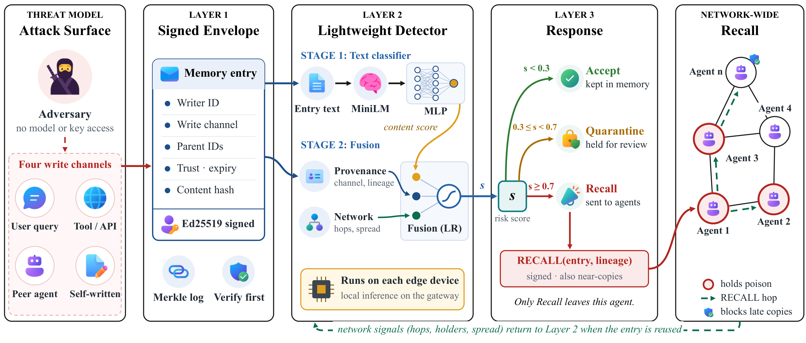

# Trust the Source, Verify the Content: Detecting and Recalling Memory Poisoning in IoT Agents

Code and results for a three-layer defense against memory poisoning in networked IoT agents: a signed memory envelope, a lightweight two-stage detector, and network-wide recall.

Author: Muhammad Farooq (Sungkyunkwan University, SKKU)



## Repository structure

```
provenance-aware-memory-defense/
├── README.md                  # Project overview, requirements, dataset setup, and run instructions
├── LICENSE                    # MIT License
├── .gitignore                 # Excludes caches, temporary artifacts, models, and raw datasets
├── requirements.txt           # Python package dependencies
├── config.py                  # Project paths, simulation parameters, and feature definitions
├── common.py                  # Detector models, evaluation metrics, and data loaders
├── run_final.py               # Main pipeline runner executing steps 1-6 and 8-15 sequentially
├── s01_build_dataset.py       # Step 1: Builds unified dataset from public sources with question-grouped splits
├── s02_simulate_mesh.py       # Step 2: Simulates IoT agent mesh with provenance and network features
├── s03_embed.py               # Step 3: Computes dense MiniLM embeddings for all dataset entries
├── s04_train_detectors.py     # Step 4: Trains detectors D1, D2, and D3 across overlap levels and seeds
├── s05_baselines.py           # Step 5: Computes embedding anomaly threshold and LLM-as-judge baselines
├── s06_stress_tests.py        # Step 6: Tests detector robustness against WordNet synonym substitutions
├── s07_edge_overhead.py       # Step 7: Benchmarks detector latency, model size, and signing overhead
├── s08_recall_sim.py          # Step 8: Simulates network-wide recall propagation across the agent mesh
├── s09_make_tables_figures.py # Step 9: Generates paper-ready LaTeX tables and figures
├── s10_two_thresholds.py      # Step 10: Evaluates three-way decision policy (accept, quarantine, recall)
├── s11_llm_paraphrase.py      # Step 11: Stress tests detectors against LLM-paraphrased poison entries
├── s12_recall_scale.py        # Step 12: Evaluates network recall scaling across mesh sizes (25, 50, 100 agents)
├── s13_laundering.py          # Step 13: Tests resilience against provenance and network laundering attacks
├── s14_end_to_end.py          # Step 14: Runs end-to-end retrieval attack and defense evaluation with an LLM agent
├── s15_collect_all.py         # Step 15: Gathers summary outputs and prints consolidated results
├── s16_threshold_memshield.py # Step 16: Evaluates embedding threshold baseline on memshield-bench subset
├── s17_llm_judge_memshield.py # Step 17: Evaluates LLM judge baseline on all memshield-bench test entries
├── data/
│   ├── raw/.gitkeep           # Placeholder for raw dataset downloads
│   └── processed/.gitkeep     # Placeholder for processed datasets and feature tables
├── docs/                      # Framework figure of the paper
│   ├── framework_fig1.pdf
│   └── framework_fig1.png
├── models/.gitkeep            # Placeholder for trained model checkpoints
└── results/
    ├── FINAL_NUMBERS.txt      # Consolidated final experimental metrics
    ├── tables/                # Experimental summary tables (.csv)
    ├── figures/               # Output figure plots (.pdf, .png)
    └── logs/                  # Log outputs
```

## Requirements

- Python version: Python 3.11 (tested with 3.11.0).
- Install dependencies:
  ```bash
  pip install -r requirements.txt
  ```
- Hardware: CPU only (no GPU needed).
- WordNet corpus for Step 6:
  ```bash
  python -c "import nltk; nltk.download('wordnet')"
  ```
- Ollama with `qwen2.5:1.5b` is needed only for the LLM steps:
  - `s05_baselines.py` (when run with `--llm`)
  - `s11_llm_paraphrase.py`
  - `s14_end_to_end.py`
  - `s17_llm_judge_memshield.py`
  To set up Ollama, install it from https://ollama.com and run:
  ```bash
  ollama pull qwen2.5:1.5b
  ```

## Data

Users download the datasets themselves into the expected folder paths:

1. **memshield-bench**: Downloaded automatically by Step 1 (`s01_build_dataset.py`) from Hugging Face (`npow/memshield-bench`, CC-BY-SA-4.0).
2. **PoisonedRAG**: Download from the official PoisonedRAG repository into `data/raw/poisonedrag/`:
   - Expected path: `data/raw/poisonedrag/nq.json`
   - Expected path: `data/raw/poisonedrag/hotpotqa.json`
   - Expected path: `data/raw/poisonedrag/msmarco.json`
   - Source: `https://raw.githubusercontent.com/sleeepeer/PoisonedRAG/main/results/adv_targeted_results/`
3. **LongMemEval**: Download from the official LongMemEval release into `data/raw/longmemeval/`:
   - Expected path: `data/raw/longmemeval/longmemeval_oracle.json`
   - Source: `https://huggingface.co/datasets/xiaowu0162/longmemeval-cleaned/resolve/main/longmemeval_oracle.json`

## How to run

- `python run_final.py`: Runs steps 1-6 and 8-15 in order (about 2.5-3 hours on a laptop CPU). Note that it first copies any existing results to `backup_entrysplit/`.
- Step 7 (edge speed) is run on its own:
  ```bash
  python s07_edge_overhead.py --device "Raspberry Pi 5 (1 core)"
  ```
  (or `--device "Laptop CPU (1 core)"`).
- Steps 16 and 17 are run after the main run:
  ```bash
  python s16_threshold_memshield.py
  python s17_llm_judge_memshield.py
  ```

### Step description

- `s01_build_dataset.py`: Build one labelled dataset from public sources with question-grouped splits.
- `s02_simulate_mesh.py`: Simulate a 25-agent IoT mesh and give every entry provenance features and network features across 3 overlap levels and 5 seeds.
- `s03_embed.py`: Turn every text into 384 numbers with MiniLM on CPU.
- `s04_train_detectors.py`: Train detectors D1, D2, D3 at every overlap level across 5 seeds.
- `s05_baselines.py`: Evaluate embedding anomaly threshold (MEMSAD-inspired) and optional LLM-as-judge baseline with qwen2.5:1.5b via Ollama.
- `s06_stress_tests.py`: Stress test against synonym replacement attacks by replacing ~25% of words in poisoned test texts with WordNet synonyms.
- `s07_edge_overhead.py`: Measure edge device computational overhead: detector latency, model disk footprint, Ed25519 signing/verification time, and memory envelope size on 1 CPU core.
- `s08_recall_sim.py`: Simulate network-wide recall propagation across the mesh with and without recall messages.
- `s09_make_tables_figures.py`: Turn the saved results into paper-ready LaTeX tables (table2.tex, table3.tex) and figures (fig2_detection, fig3_recall).
- `s10_two_thresholds.py`: Test the three-way decision threshold policy (risk < t_low accept, t_low <= risk < t_high quarantine, risk >= t_high recall).
- `s11_llm_paraphrase.py`: Stress test detector robustness against poison rewritten by a local LLM (qwen2.5:1.5b via Ollama) while preserving semantic meaning.
- `s12_recall_scale.py`: Evaluate scalability of network-wide recall across mesh sizes of 25, 50, and 100 agents.
- `s13_laundering.py`: Test detector resilience against provenance and network laundering attacks where attackers rewrite poison as self-authored entries.
- `s14_end_to_end.py`: End-to-end evaluation with a real LLM agent (qwen2.5:1.5b) testing attack success rate (ASR) and retrieval accuracy across defense configurations.
- `s15_collect_all.py`: Print every final number in one place from saved result tables into results/FINAL_NUMBERS.txt.
- `s16_threshold_memshield.py`: Embedding-threshold baseline on the memshield-bench subset (re-scoring only, F1-dagger in Table 2).
- `s17_llm_judge_memshield.py`: LLM judge on all memshield-bench test entries (F1-dagger in Table 2).

## Results map

- Table 2 (detection results): Generated by `s04_train_detectors.py` (D1, D2, D3) and `s05_baselines.py` (baselines), formatted by `s09_make_tables_figures.py` (`results/tables/table2.tex`); memshield-bench subset F1 for baselines is computed by `s16_threshold_memshield.py` (`results/tables/threshold_memshield.csv`) and `s17_llm_judge_memshield.py` (`results/tables/llm_judge_memshield.csv`).
- Table 3 (edge cost): Generated by `s07_edge_overhead.py` (`results/tables/table3_edge.csv`), formatted by `s09_make_tables_figures.py` (`results/tables/table3.tex`).
- Figures:
  - `results/figures/fig2_detection.pdf` and `results/figures/fig2_detection.png`: memshield-only F1 across overlap levels, saved by `s09_make_tables_figures.py`.
  - `results/figures/fig3_recall.pdf` and `results/figures/fig3_recall.png`: agents holding poison over time, saved by `s09_make_tables_figures.py`.
  - `docs/framework_fig1.pdf`: framework architecture diagram (PNG at `docs/framework_fig1.png`).
- Recall at 50/100 agents: `s12_recall_scale.py` (`results/tables/recall_scale.csv`).
- Paraphrase stress tests: `s06_stress_tests.py` (WordNet synonym substitutions), `s11_llm_paraphrase.py` (LLM rewrites, `results/tables/paraphrase_summary.csv`).
- Laundering test: `s13_laundering.py` (`results/tables/laundering_summary.csv`).
- Two thresholds: `s10_two_thresholds.py` (`results/tables/two_thresholds.csv`).
- End-to-end attack test: `s14_end_to_end.py` (`results/tables/e2e_summary.csv`).
- Consolidated numbers: `s15_collect_all.py` (`results/FINAL_NUMBERS.txt`).

## Notes

Provenance and network features are simulated over a small-world network topology (see `s02_simulate_mesh.py`). All detector results use 5 random seeds (seeds 0 through 4) and report mean and standard deviation.

## Citation

Citation details will be added after publication.

Repository: https://github.com/Muhammadfarooq27/provenance-aware-memory-defense

## License

MIT License, Copyright (c) 2026 Muhammad Farooq. The datasets keep their original licenses.

